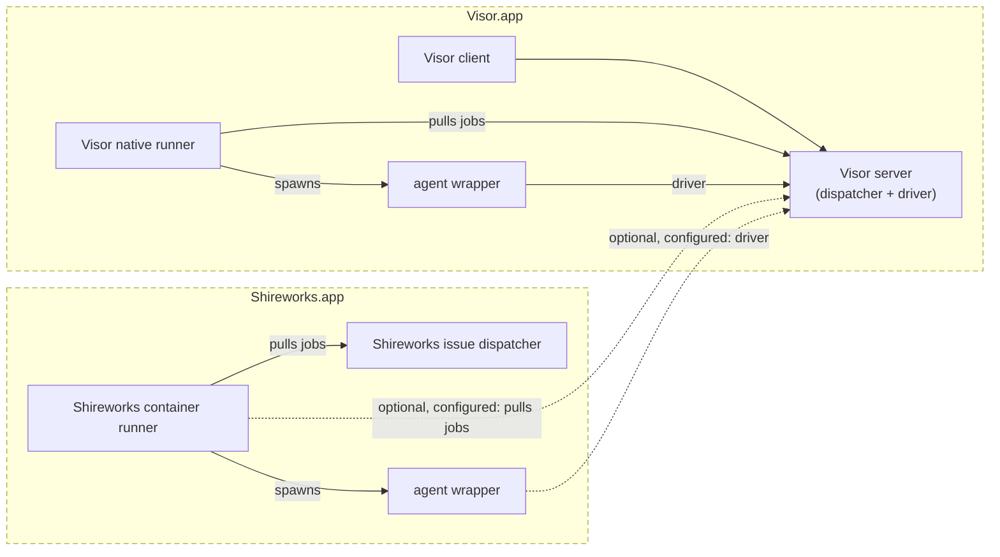

# agent_protocol

What [Visor](https://github.com/AttilaTheFun/visor) and Shireworks share
about agents, and the one program both run their agents under. Visor and
Shireworks are standalone apps; this is how they interact.

- **Three gRPC services** (`protos/agent_protocol/v1`):
  - **AgentDispatcher**: the queue of agent jobs. Runners pull from it, as
    GitHub's runners pull CI jobs. Visor's server implements it, and so does
    Shireworks' server (its jobs from GitHub issues).
  - **AgentDriver**: where an agent is watched and steered. The wrapper
    dials out to it (`AGENT_DRIVER_URL`) and keeps one stream open: its
    conversation and what it is doing go up, and messages, permission
    answers, model changes and interrupts come down. It's `claude -p`
    across harnesses, over gRPC, outbound from the agent. Visor's server
    implements it.
  - **AgentWrapper**: the wrapper itself, for the runner that started it.
- **`agent-wrapper`**: normalizes Claude, Codex and the other harnesses into
  one interface, and keeps what isn't in their logs (thinking, subagents,
  tool calls under way) and the queued messages. The driver is optional:
  without one, a job runs headless.
- **`agent-network`**: a container's only network (docs/retiring-multipass.md,
  section 2). Run as the container's first process (`agent-network run --
  <command>`), it answers DNS with fake addresses and sends every TCP
  connection out by name over the relay's socket to agent-proxy, on the
  host; nothing secret is inside. Linux only (SwiftPM).
- **An agent's id** is a UUID with its dispatcher's URL (as runners reach it,
  through MultiPass), made before any session exists, and carried from
  dispatcher to runner to wrapper to driver.



Dashed boxes are the apps, solid ones the parts in them, and dashed arrows
optional links, configured. MultiPass's proxying is left out: every link
out of a container, and all of an agent's outbound traffic, goes through it.

## Building

```sh
swift build                    # AgentProtocol and agent-wrapper
swift test
tools/generate.sh              # the protos' Swift, after changing a proto (needs protoc)
tools/build_static.sh out      # agent-wrapper as one static file per Linux architecture (Swift 6.4.0)
```

Releases go through Reviews, as Logan's other repositories' do. CI's `run:
release` (by hand, on main, with `version`) runs verify, the tests and their
proof, and the static build. Then it proposes a draft release, `v<version>`,
with `proof.zip`, `proof-diff.json`, `agent-wrapper-linux-arm64` and `-amd64`,
and `SHA256SUMS`. Logan's Release in Reviews publishes it, which makes the
tag. Depend on a release by version:
`.package(url: "https://github.com/AttilaTheFun/agent_protocol.git", from: "0.1.0")`.

`tools/build_static.sh` builds with Swift's static Linux SDK (musl), so
`agent-wrapper-linux-arm64` and `-amd64` run in any container image, with
nothing to install. gRPC's TLS (NIOSSL's BoringSSL) is C++, so the script
links the SDK's libc++ alone (its comments say how).

The protos' Swift is generated and kept in `Sources/AgentProtocol`, so a
package that depends on this one needs no protoc. CI checks it matches.

## agent-wrapper

```sh
AGENT_DRIVER_URL=http://127.0.0.1:7434 agent-wrapper --agent <uuid> --dispatcher <url> \
    --harness claude --cwd ~/Developer/project --title "A task" --prompt "Start here"
```

It runs the harness (Claude Code in print mode, stream JSON both ways),
sends its first prompt, and takes later messages from its driver. It ends
when the agent does. `AGENT_WRAPPER_CLAUDE` stands in for `claude`, as
the tests' stand-in does.

**A session moved to a runner** comes as a job with `resume_session_id` and
`sources`. Before the harness starts, the wrapper:
- fetches the conversation's files from its driver (`AgentDriver.Conversation`)
  into Claude's folder (`$CLAUDE_CONFIG_DIR`, else `~/.claude`), keyed to the
  folder it will work in;
- clones each source under `AGENT_SOURCES_DIR` by its name and ref;
- then runs `claude --resume`.
Nothing already there is overwritten. A job with no working directory, on a
runner that sets `AGENT_SESSIONS_DIR`, works in `<dir>/Claude/<agent>`.

**The agent's token** (`Job.token`, minted by the dispatcher;
docs/retiring-multipass.md, section 4): a runner hands it to the wrapper
in `AGENT_TOKEN`, beside `AGENT_ID` and `AGENT_JOB`, never in `AGENT_JOB`
or on a command line. The wrapper shows it on each call it makes for the
agent, its driver's `Connect` and `Conversation` and its dispatcher's
`Report`, as gRPC metadata `authorization: Bearer <token>`, and takes a
fresh one when the driver sends it (`DriverMessage.token`). The harness
isn't given it: its MCP server reaches the driver through the wrapper
(below), so the token never leaves the wrapper.

**The agent's MCP server, "visor", and its approvals.** Claude is given
the driver's MCP tools (Visor's `send_message`, `read_inbox`,
`list_sessions`, …), named `mcp__visor__<tool>` as in a session on the
driver's own computer, and, when the agent asks before acting
(`skip_permissions` false), its permission prompts go to the driver:

- The wrapper listens on a Unix socket in a private folder of its own
  (`$TMPDIR/agent-mcp-XXXXXX/mcp.sock`, the folder 0700, the socket 0600,
  removed when it ends) and starts Claude with
  `--mcp-config '{"mcpServers":{"visor":{"type":"stdio","command":"<agent-wrapper>","args":["mcp"],"env":{"AGENT_MCP_SOCKET":"<socket>"}}}}'`
  (and `AGENT_MCP_SOCKET` in Claude's environment too), plus
  `--permission-prompt-tool mcp__visor__approve` when the agent asks, or
  `--permission-mode bypassPermissions` when it acts. A resumed session
  the same. Nothing secret is on a command line or in the configuration.
- `visor` is the only server the wrapper adds, and it takes none of
  Claude's own away: no `--strict-mcp-config`, `--bare` or
  `--setting-sources`, and Claude runs with the wrapper's environment
  (`HOME`, `CLAUDE_CONFIG_DIR`; less `AGENT_TOKEN`) in the job's working
  directory. So Claude loads its user and project MCP servers as it would
  anyway, beside `visor`. In a Shireworks container that is where
  Shireworks' MCP comes from: the container's own Claude configuration,
  reaching Shireworks through the container network and agent-proxy
  (`/mcp/shireworks`). Visor's MCP comes through the wrapper (this
  server) and nothing else of the driver's computer: Visor answers it
  with its own tools, not the MCP servers that computer passes on to its
  native sessions (Logan, 2026-11-16). GitHub is no MCP server at all:
  `gh` is the plain CLI, over HTTPS through the container network and
  agent-proxy, which adds the agent account's credentials.
- `agent-wrapper mcp` is that server: a pipe between Claude's MCP client
  (its stdin and stdout) and the wrapper's socket, nothing more.
- The wrapper relays each JSON-RPC message, verbatim, to the driver as
  `WrapperMessage.mcp` (`McpRequest`: its own `id` for the request, empty
  for a notification; the `json`; the `client`, which MCP connection), and
  writes each `DriverMessage.mcp` (`McpResponse`: the same `id`, the
  `json`) back to the connection that asked. An `McpResponse` with no id is
  the server's own message (a `notifications/tools/list_changed`, say), for
  its `client`, or for every connection when that is empty.
- `approve` is the wrapper's: it adds it to the driver's `tools/list`
  answer (when the agent asks before acting and the list lacks it), and a
  `tools/call` of `approve` (`{tool_name, input, tool_use_id}`) never
  reaches the driver as MCP: it goes up as `WrapperMessage.approval`
  (`ApprovalRequest`: `id`, `tool`, a one-line `summary`, `input_json`,
  `tool_use_id`), and the driver's `DriverMessage.approval` (`Approval`:
  `request_id`, `allow`, `reason`, `updated_input_json`) answers Claude as
  its permission prompt expects, `{"behavior":"allow","updatedInput":…}`
  (the driver's `updated_input_json`, else the input as asked) or
  `{"behavior":"deny","message":…}` (the `reason`, else "The user denied
  this."). While it waits it tells Claude so every 20 s (MCP progress),
  when Claude takes progress. Whatever happens, an approval unanswered 25
  minutes after it was asked is denied (`MCPRelay.approvalDeadline`):
  progress or not, and whether or not the driver has ever answered (one
  that hasn't is named in the reason). An approval the agent gives up on
  (or that times out) is withdrawn: `WrapperMessage.approval_withdrawn`
  with its id. An approval still waiting is sent again on each new
  connection to the driver, once a connection (the same request asked
  twice is asked once).
- A job that skips permissions has no `approve`: it isn't listed, and a
  call to it gets a JSON-RPC error (-32602) without reaching the driver.
- A message from Claude's MCP client is at most 3 MiB
  (`MCPRelay.defaultLineLimit`): each goes to the driver whole in one
  gRPC message on the `Connect` stream, and one over gRPC's 4 MiB limit
  would fail the whole stream. A longer line is discarded as it comes,
  never held whole, and answered with a JSON-RPC error (-32600, for the
  request's id when the line ends with it, else null).
- A driver that doesn't serve MCP (an older one, which answers nothing):
  an `initialize` it was sent and left unanswered for 15 s is answered by
  the wrapper (a server with `approve` alone); from then on tool calls
  get a JSON-RPC error saying the driver doesn't serve MCP, and approvals
  are denied, saying the driver can't take approvals. With no driver at
  all, the same at once. A tool call the driver leaves unanswered fails
  after 15 minutes, and one under way when the connection drops fails
  then: nothing waits without end.

**What a driver (Visor) does for this**, on `Connect`:
- Answer each `WrapperMessage.mcp` that has an `id` with a
  `DriverMessage.mcp` carrying the same `id`, whose `json` is its MCP
  server's JSON-RPC response to the request's `json` (`initialize`,
  `tools/list`, `tools/call`, `ping`, …), run for the agent's session: the
  one whose token the stream's `Connect` showed (`authorization: Bearer`).
  Take one with no `id` as a notification (`notifications/initialized`,
  `notifications/cancelled`) or the client's answer to a request of the
  server's own. Keep per-connection state by `client`. `approve` need not
  be listed (the wrapper adds it) and is never called through MCP. Visor
  lists and serves only its own tools here (`list_sessions`,
  `send_message`, `read_inbox`, …), never the MCP servers its computer
  passes on to native sessions: the agent's other servers are its
  container's.
- Answer each `WrapperMessage.approval` with a `DriverMessage.approval`
  of the same `request_id`: `allow`, and when it changes the input (an
  AskUserQuestion's answers) `updated_input_json`; or not, with a
  `reason`. De-duplicate by `id`: a waiting approval is sent again on each
  new connection (after a reconnect), so the same `id` can come more than
  once, and must be prompted and answered once (Visor does, since
  visor#438). Drop the prompt on `approval_withdrawn`.
- A driver that serves MCP is taken to answer approvals too.

Not yet: Codex and OpenRouter, interrupts and model changes, and the
AgentWrapper service. Its harnesses
will come from Visor's agent code (visor_agent).

## Licence

Apache 2.0, as Visor's.
